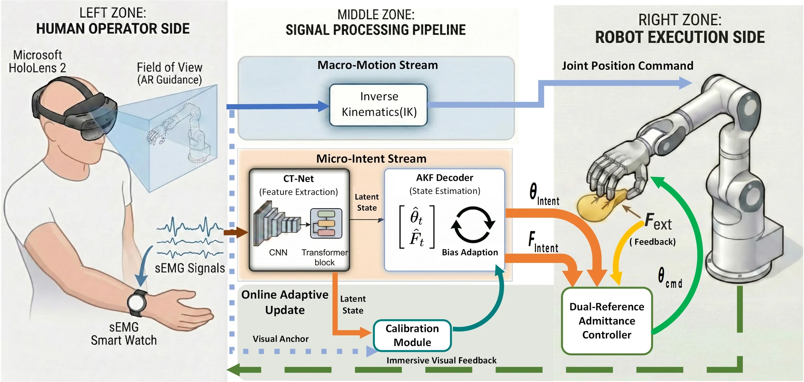

# Visuo-neuromotor Integration for Flexible Human-Robot Interactions

**Status: Under Review / 在投**

[Project page](https://cyberyyc.github.io/Visuo-neuromotor-Integration-for-Flexible-Human-Robot-Interactions/)

Visuo-neuromotor integration combines AR guidance and sEMG intention decoding for flexible human–robot interaction. This repository provides selected core modules for the CNN–Transformer, adaptive Kalman decoder, and dual-reference variable admittance controller.

## Core modules

- `core/preprocessing.py`: MVC normalization, causal filtering, and aligned sliding windows.
- `core/ctnet.py`: temporal/spatial CNN and Transformer encoder with a 64-dimensional feature projection and six-output regression head.
- `core/kalman.py`: block-structured Kalman identification and online visual-anchor bias adaptation.
- `core/admittance.py`: force-dependent variable admittance using motion and force references.
- `examples/training_stages.py`: supervised CT-Net learning followed by frozen-feature Kalman fitting.
- `examples/online_decoding.py`: signal-window to decoded intention and hand-command pipeline.

## Method and interfaces

**Input:** eight sEMG channels sampled at 1,000 Hz, segmented into 200-sample windows with a 20-sample stride. Batched encoder input is `(batch, 8, 200)`.

**Targets:** six normalized values ordered as `[angle_MRL, angle_index, angle_thumb, force_MRL, force_index, force_thumb]`. Reference labels are sampled at 200 Hz and aligned to each window endpoint.

**Stage I:** train the CNN–Transformer with six-target supervised regression. The network uses temporal and spatial convolutions, two Transformer encoder layers with two attention heads, and a 64-dimensional latent feature projection. Optimizer: AdamW, learning rate `5e-4`, weight decay `1e-3`, batch size 128, up to 200 epochs.

**Stage II:** freeze the encoder and fit Kalman dynamics and feature observations by least squares on ordered training sequences. The 12-dimensional state is `[angles(3), angle_rates(3), forces(3), force_rates(3)]`. Kinematic and dynamic transitions are fitted in separate 6 × 6 blocks.

**Online:** estimate three angles and three forces from the latent feature stream. Sparse visual anchors update the observation bias with EMA coefficient 0.05. The controller combines decoded joint intention, intended force, and external force at a 20 ms interval; damping varies from 0.06 to 0.14 and stiffness from 2 to 100.

Install dependencies with `python -m pip install -r requirements.txt`. The examples expose the two training stages and the `IntentPipeline` interface for online decoding.

## Manuscript results

The manuscript reports mean angle R² **0.875** and RMSE **0.120**, and mean force R² **0.907** and RMSE **0.109**, across the three corresponding outputs. The longitudinal decoding study uses one participant, 15 sessions over 30 days, and a 90% / 10% training and test split.

**Publication status: Under Review.**
